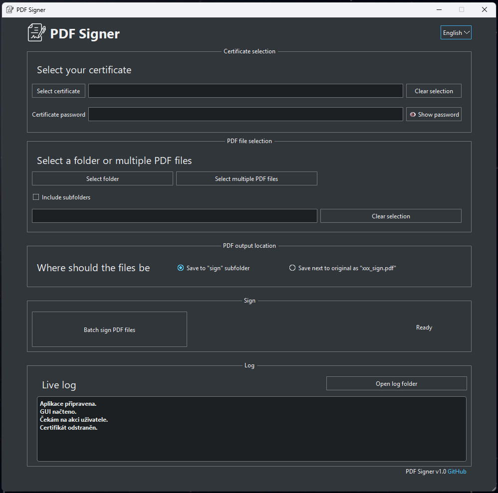

# PDF Signer

🇬🇧 English | [🇨🇿 Česky](README_CZ.md)

**[Download PDF Signer](../../releases)**

A free Windows desktop application for digitally signing PDF documents using PKCS#12 certificates (.p12 / .pfx).

PDF Signer provides a simple graphical interface and supports batch processing of up to **500 PDF files** at a time.

> ⚠️ PDF Signer requires a valid PKCS#12 certificate (.p12 or .pfx) containing a private key. Other certificate formats and hardware signing tokens are not supported.

---

## 🚧 Project Status

### Version 1.0

First public release.

---

## 🖼️ Screenshots & Demo

### Main Application Window

---

## 🧰 Features

- Digitally signs PDF documents using PKCS#12 certificates (.p12 / .pfx).
- Places the visible signature in the bottom-right corner of the **last page** of each PDF document.
- Supports batch processing of up to 500 PDF files.
- Provides a simple graphical user interface.
- Supports English and Czech.
- Displays processing progress and status messages.
- Generates log files for reviewing processing results.
- Processes PDF documents locally.
- Free for personal and commercial use.

---

## ⚠️ Important Notice

- PDF Signer does not issue digital certificates.
- A valid PKCS#12 certificate (.p12 or .pfx) containing a private key is required.
- Other certificate formats and hardware signing tokens are not supported.
- The visible signature is always placed in the bottom-right corner of the last page. Its position cannot be customized.
- The validity and legal effect of a digital signature depend on the certificate, signing method and applicable requirements.
- Always verify signed documents before distributing or submitting them.

---

## 📝 License

[Freeware License](LICENSE)

PDF Signer is free for personal and commercial use.

The software is proprietary and its source code is not publicly distributed. Redistribution and modification are subject to the terms of the freeware license.

Copyright © 2026 Tom Salaj. All rights reserved.

---

## 🚀 Final Words

**Learn, code, enjoy — good luck!**  
*Tom Salaj*

