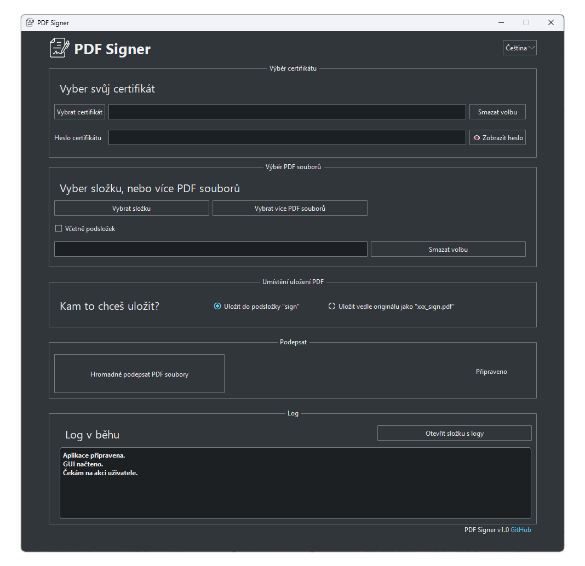

# PDF Signer

[🇬🇧 English](README.md) | 🇨🇿 Česky

**[Stáhnout PDF Signer](../../releases)**

Bezplatná desktopová aplikace pro Windows určená k digitálnímu podepisování PDF dokumentů pomocí certifikátů PKCS#12 (.p12 / .pfx).

PDF Signer nabízí jednoduché grafické rozhraní a umožňuje podepsat až **500 PDF souborů** v jedné dávce.

> ⚠️ PDF Signer vyžaduje platný certifikát PKCS#12 (.p12 nebo .pfx) obsahující soukromý klíč. Jiné formáty certifikátů ani hardwarové podpisové tokeny nejsou podporovány.

---

## 🚧 Stav projektu

### Verze 1.0

První veřejné vydání.

---

## 🖼️ Snímky obrazovky a ukázky

### Hlavní okno aplikace

---

## 🧰 Funkce

- Digitálně podepisuje PDF dokumenty pomocí certifikátů PKCS#12 (.p12 / .pfx).
- Umisťuje viditelný podpis do pravého dolního rohu **poslední stránky** každého PDF dokumentu.
- Podporuje dávkové podepisování až 500 PDF souborů v jedné dávce.
- Nabízí jednoduché grafické uživatelské rozhraní.
- Podporuje češtinu a angličtinu.
- Zobrazuje průběh zpracování a stavové zprávy.
- Vytváří protokolové soubory pro kontrolu výsledků zpracování.
- Zpracovává PDF dokumenty lokálně.
- Je zdarma pro osobní i komerční použití.

---

## ⚠️ Důležitá upozornění

- PDF Signer nevydává digitální certifikáty.
- Je vyžadován platný certifikát PKCS#12 (.p12 nebo .pfx) obsahující soukromý klíč.
- Jiné formáty certifikátů ani hardwarové podpisové tokeny nejsou podporovány.
- Viditelný podpis je vždy umístěn v pravém dolním rohu poslední stránky. Jeho pozici nelze měnit.
- Platnost a právní účinky digitálního podpisu závisí na použitém certifikátu, způsobu podepsání a příslušných požadavcích.
- Před odesláním nebo předáním podepsaných dokumentů vždy ověřte jejich podpisy.

---

## 📝 Licence

[Freeware licence](LICENSE)

PDF Signer je zdarma pro osobní i komerční použití.

Software je proprietární a jeho zdrojový kód není veřejně distribuován. Další šíření a úpravy se řídí podmínkami freeware licence.

Copyright © 2026 Tom Salaj. Všechna práva vyhrazena.

---

## 🚀 Final Words

**Learn, code, enjoy — good luck!**  
*Tom Salaj*

